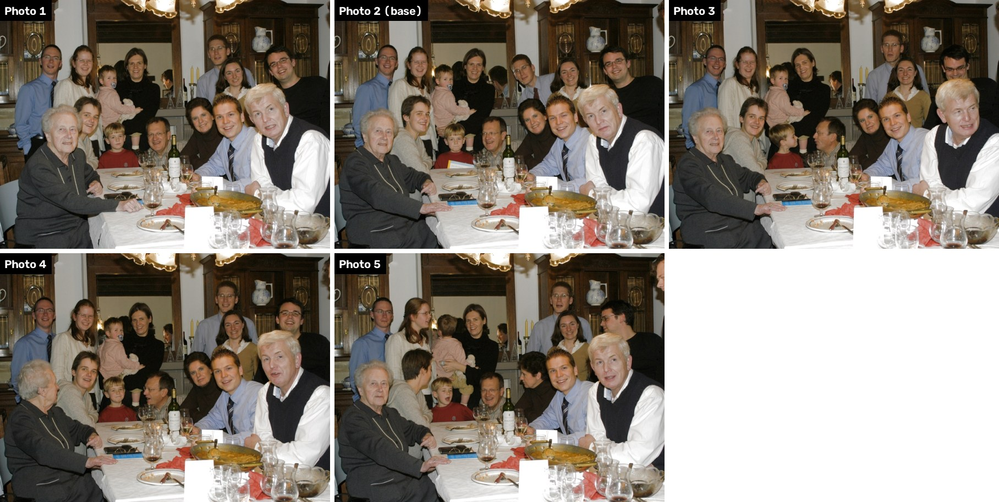
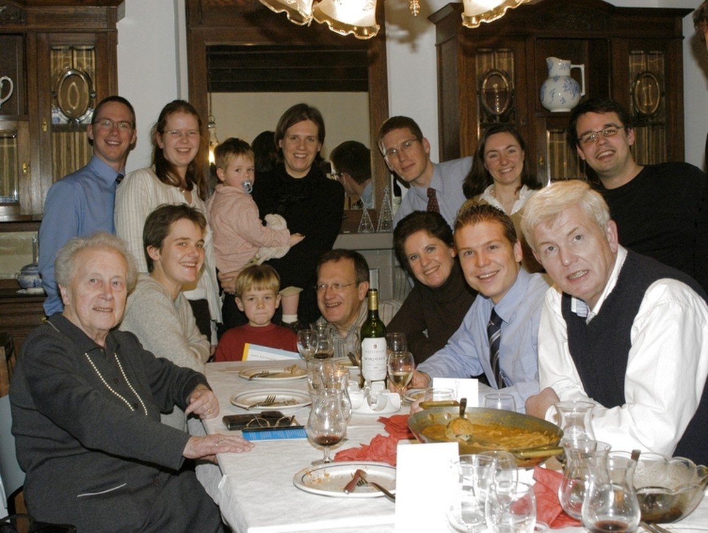
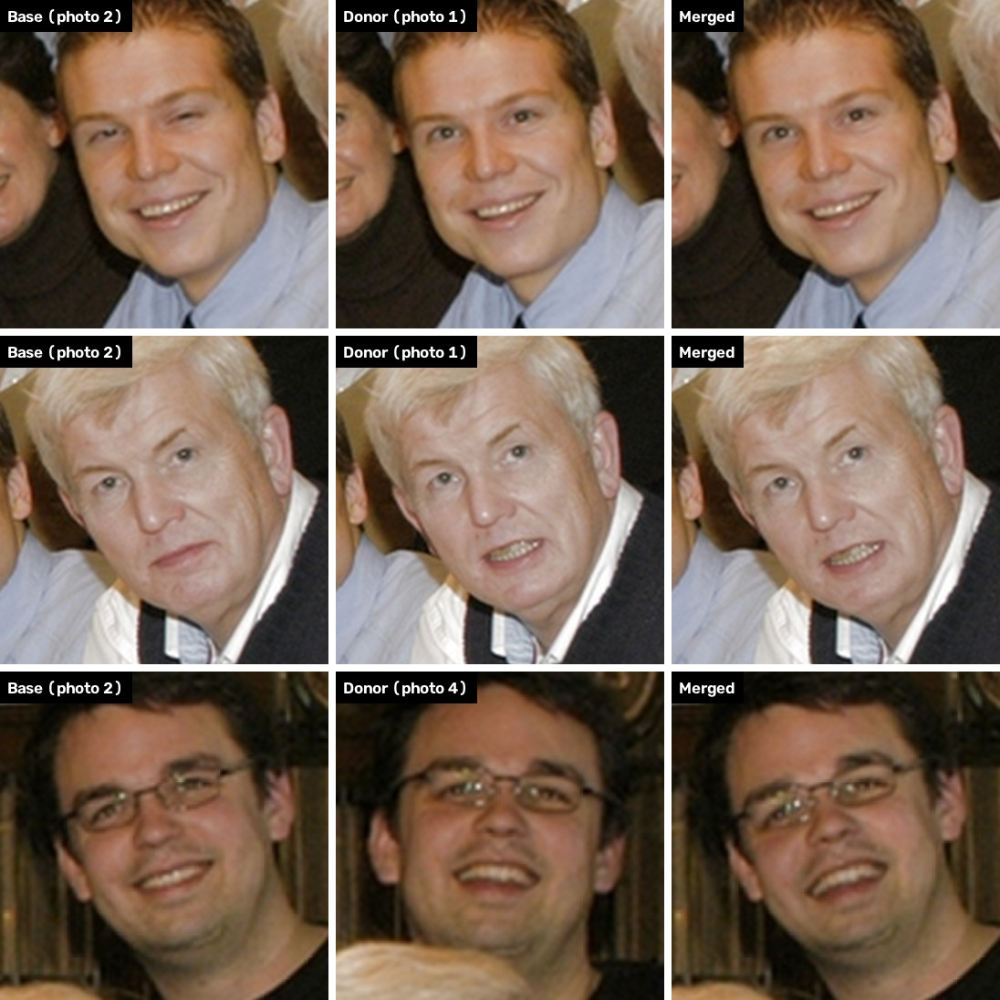

# best-take

An Android application for the standard Google Pixel 10 that combines the
preferred photographed expression of each person from a short sequence into
one natural group photo. Editing runs locally on the device.

The implementation specification is [docs/design.md](docs/design.md). Work is
tracked in [GitHub issues](https://github.com/alecjacobson/best-take/issues),
grouped by the milestones in the design's delivery plan.

## Example

The inputs are the five-shot family portrait from Agarwala et al.,
[Interactive Digital Photomontage](https://grail.cs.washington.edu/projects/photomontage/)
(SIGGRAPH 2004). No single shot is good for everyone: in photo 2, for
example, one man squints and another has stopped smiling.



**This result is forced, not automatic.** Left to itself the tool currently
keeps photo 1 and replaces one face (see
[issue 56](https://github.com/alecjacobson/best-take/issues/56)); here the
base photo and three replacements were chosen by hand. The published images are
752x566, below the tool's minimum face size, so they were enlarged 3x first.

```sh
python3 tools/best_take.py up3_*.png --base 1 --lock 5=0 --lock 9=0 --lock 10=3 \
  --output merged.jpg
```



Only the inner face is replaced; hair, ears, the head outline, and everything
outside the face come from the base photo.



The Android app's editor, running on an emulator with a different, single-person set:


## Layout

| Path | Contents |
| - | - |
| `docs/` | Design specification and engineering notes. |
| `engine/` | C++ image engine: geometry, masks, color, compositing, selection, validation. Independent of the UI, with a CPU reference implementation and host tests. |
| `app/` | Kotlin and Jetpack Compose Android application. |
| `tools/` | Host-side scripts for running the engine on photo sets. |

## Building

Engine and host tests (any platform with CMake and a C++17 compiler):

```sh
cmake -S engine -B engine/build && cmake --build engine/build -j 8
ctest --test-dir engine/build --output-on-failure
```

Android application (JDK 17, Android SDK with platform 36, NDK 27.0.12077973, CMake 3.22.1):

```sh
./gradlew :app:testDebugUnitTest :app:assembleDebug
```

The build downloads the analysis models listed in [docs/models.md](docs/models.md),
verifies their hashes, and packages them so editing works offline. The app
requires Android 16 on arm64.

To try a merge without a phone, see [tools/README.md](tools/README.md).

## Status

Early development. See the milestone issues for what is implemented and what
still requires measurement on a Pixel 10.
