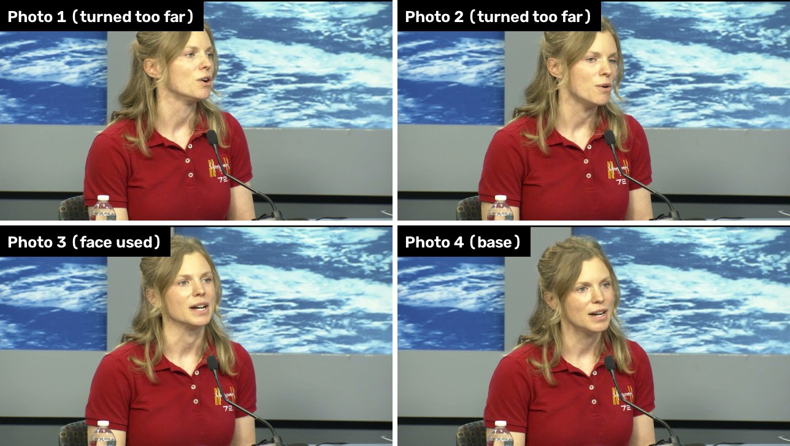
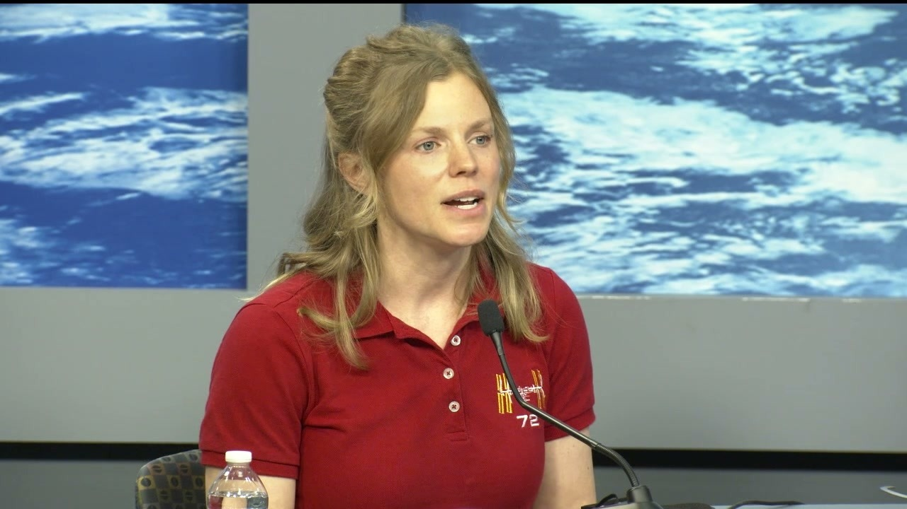
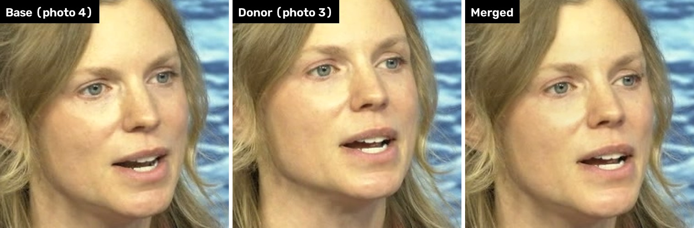
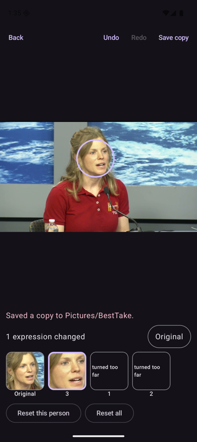

# best-take

An Android application for the standard Google Pixel 10 that combines the
preferred photographed expression of each person from a short sequence into
one natural group photo. Editing runs locally on the device.

The implementation specification is [docs/design.md](docs/design.md). Work is
tracked in [GitHub issues](https://github.com/alecjacobson/best-take/issues),
grouped by the milestones in the design's delivery plan.

## Example

This is what the current build produces. The inputs are four frames taken a
moment apart from a public-domain
[NASA crew news conference video](https://images.nasa.gov/details/jsc2024m000139_Crew-9_Crew_News_Conference).



Left to itself, the tool keeps photo 4 unchanged: it scores photo 3's face
slightly worse and rejects photos 1 and 2 because the head is turned too far
from the base. To show a merge, the result below forces the face from photo 3
onto photo 4:

```sh
python3 tools/best_take.py photo1.jpg photo2.jpg photo3.jpg photo4.jpg \
  --base 3 --lock 0=2 --output merged.jpg
```



Only the inner face is replaced; hair, ears, the head outline, and everything
outside the face come from the base photo.



The same choice made in the Android app, running on an emulator:



This example has one person in 1280x720 video frames. Group photos and
full-resolution camera photos have not been tested yet.

## Layout

| Path | Contents |
| - | - |
| `docs/` | Design specification and engineering notes. |
| `engine/` | C++ image engine: geometry, masks, color, compositing, selection, validation. Independent of the UI, with a CPU reference implementation and host tests. |
| `app/` | Kotlin and Jetpack Compose Android application. |
| `tools/` | Host-side scripts for running the engine on photo sets. |

## Building

Engine and host tests (any platform with CMake and a C++17 compiler):

```sh
cmake -S engine -B engine/build && cmake --build engine/build -j 8
ctest --test-dir engine/build --output-on-failure
```

Android application (JDK 17, Android SDK with platform 36, NDK 27.0.12077973, CMake 3.22.1):

```sh
./gradlew :app:testDebugUnitTest :app:assembleDebug
```

The build downloads the analysis models listed in [docs/models.md](docs/models.md),
verifies their hashes, and packages them so editing works offline. The app
requires Android 16 on arm64.

To try a merge without a phone, see [tools/README.md](tools/README.md).

## Status

Early development. See the milestone issues for what is implemented and what
still requires measurement on a Pixel 10.
