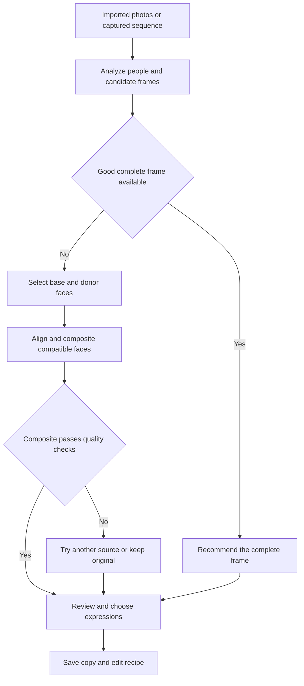

**Version one target:** Standard Google Pixel 10. **Design date:** 18 November 2026. **Status:** Implementation specification.

Build an Android application that combines the preferred photographed expression of each person from a short sequence into one natural group photo. The first release runs its editing pipeline locally on the standard Pixel 10 and includes both photo import and guided capture.

The central design decision is to preserve a selected donor face, align its head pose without undoing its expression, and solve the transition into the base photograph. Small neural models provide detection, landmarks, masks, ranking, and confidence. Geometric rendering preserves photographic detail. A learned boundary correction is an enhancement to evaluate after the deterministic compositor works.

The release quality goal is Pixel-comparable output on the declared evaluation population, measured with the noninferiority gate below, while offering a responsive, reversible editor. Superiority is a separate objective to establish experimentally. Full generative face reconstruction is a separate research extension.

# Product requirements and release scope

## What the user can do

A user can import a group of related photographs or capture a short sequence, receive a recommended result, tap any person, select another expression, change the base photograph, compare with the original, and save a full-resolution copy. Every selected expression remains traceable to a source image.

The default recommendation favors a good complete photograph when one exists. Composition becomes useful when different people look best in different frames. Neutral, serious, and funny expressions remain valid choices; smile intensity is a preference signal rather than the definition of quality.

Version one must include:

- JPEG, HEIF, and supported Ultra HDR photo import through Android photo selection and sharing.

- Automatic grouping within the selected input set, with explicit add and remove controls.

- A guided capture mode using the rear main camera or front camera, with a timer and clear capture completion.

- Automatic base selection and per-person expression suggestions.

- A face chooser with original, recommended, and alternative expressions.

- Base-frame selection, undo and redo, per-person reset, global reset, zoom, and hold-to-compare.

- Correction of missed faces and incorrect person associations.

- A persistent project with source references and a versioned edit recipe.

- Color-managed preview, full-resolution export, and system sharing.

- Offline editing after the required models and source photos are present.

The initial supported editing envelope is 2–20 selected photos and up to 20 tracked people. This is a product limit, not a guarantee that every face is mergeable. The normal performance workload is eight approximately 12 MP photos containing six people. Small faces, heavy occlusions, and incompatible head turns can remain unchanged while other people are edited.

## Scope boundaries

The release targets the standard Pixel 10. Pixel 10 Pro, other Android devices, and iOS are later qualification targets. Keep the image engine independent of the UI, but do not build or benchmark additional platform backends for this release.

The normal editor uses expressions photographed in the selected moment. It does not search an entire face library or invent an expression when no usable source exists. Whole-person insertion, an Add Me equivalent, animated output, and arbitrary identity swapping are separate features. Motion-photo or video frames can become optional donor inputs after their resolution and decoder paths are qualified; the initial output remains a still photograph.

# Pixel 10 baseline and Google behavior

## Reference hardware

The standard Pixel 10 has Google Tensor G5, 12 GB RAM, a 1080 × 2424 display supporting 60–120 Hz, a 48 MP rear wide sensor, and a 10.5 MP front camera. These specifications identify the reference device; sensor megapixels do not guarantee a particular public-API capture stream. Use negotiated output sizes and record them in the device capability report. [Google Pixel 10 specifications](https://store.google.com/us/product/pixel_10_specs?hl=en-US).

Use the rear main camera at a fixed 1× setting for the primary capture profile. Qualify the front camera separately, including mirrored preview versus saved-image orientation. Do not switch physical cameras or zoom during one sequence.

## What Google has disclosed

Google describes Best Take as a collection of models that groups nearby photographs using timestamps, evaluates head pose and expressions, proposes faces, and blends selected regions with technology adapted from Magic Eraser and Cinematic Photos. Its Tensor G3 announcement explicitly describes Best Take models running on-device. Google also categorizes Best Take as non-generative compositing in its transparency documentation. These disclosures establish the broad behavior, but do not publish the production alignment model, masks, renderer, or training recipe. [How Best Take works](https://blog.google/products-and-platforms/products/photos/how-google-photos-best-take-works/), [on-device processing](https://blog.google/products-and-platforms/devices/pixel/google-tensor-g3-pixel-8/), [composite metadata](https://blog.google/products-and-platforms/products/photos/ai-editing-transparency/).

Auto Best Take, introduced with Pixel 10, analyzes up to 150 frames over several seconds, seeks a good whole frame, and blends a result when necessary. The analyzed-frame count is not a published promise of 150 retained full-resolution donor photographs. Its supported workflow requires Pixel Camera, Google Photos, and Top Shot. [Pixel 10 camera announcement](https://blog.google/products-and-platforms/devices/pixel/pixel-10-camera-features/), [Top Shot and Auto Best Take help](https://support.google.com/pixelcamera/answer/9937175?hl=en).

The familiar manual UI uses selectable face bubbles. The proposed app retains this interaction while adding explicit source inspection, base selection, and durable project state. [Google Photos feature help](https://support.google.com/photos/answer/14674995?hl=en).

## Relationship to the stock camera

Implement an independent editor using public Android APIs. CameraX Extensions exposes modes such as HDR, Night, Auto, Bokeh, and Face Retouch; its documented interface does not provide a Best Take operation. Treat stock Best Take as a comparison baseline rather than a callable rendering component. [CameraX Extensions](https://developer.android.com/media/camera/camerax/extensions-api).

Evaluate two different questions separately. For rendering quality, feed the same source files into this app and Google Photos Best Take. For capture quality, compare the integrated app capture experience with stock Pixel Camera and Auto Best Take. The second comparison includes differences in acquisition and proprietary camera processing.

# Application architecture

Use Kotlin and Jetpack Compose for the Android application, a C++ engine for image geometry and compositing, and LiteRT for learned inference. Use GPU compute for warps, masks, image pyramids, and final composition; choose the exact GPU implementation after profiling on Pixel 10. The primary candidate is Vulkan compute, with a CPU reference implementation for verification.

The application has six boundaries:

| Module | Responsibility |
| - | - |
| Capture and import | Obtain assets, validate permissions, read metadata, and produce normalized image descriptors. |
| Analysis | Detect people, associate faces, estimate landmarks and pose, compute technical quality, and generate candidate masks. |
| Selection | Choose a base, rank donor candidates, resolve conflicts, and produce a proposed edit recipe. |
| Rendering | Align, harmonize, composite, and validate selected candidates at preview and export resolutions. |
| Editor | Present choices, maintain explicit user locks and history, and request incremental renders. |
| Project and export | Persist sources and recipes, restore interrupted work, encode output, and preserve appropriate metadata. |



Analysis and rendering run off the UI thread. A project revision identifies each request; completion from an obsolete revision is discarded. Cancellation stops unnecessary work without discarding the last accepted preview.

Separate the preview cache from the authoritative recipe. Cached patches accelerate interaction; the recipe records the selected sources and processing decisions. Export executes that recipe at the original output size. It never silently chooses different faces or samples a new generative result.

# Capture and input preparation

## Import first

The first end-to-end milestone starts from existing photos. This isolates the merging problem from camera acquisition and lets the app use photographs already produced by stock Pixel Camera.

Use Android photo selection and ACTION_SEND or ACTION_SEND_MULTIPLE integration. Resolve access to the selected originals and retain project-owned copies when durable reopening requires them. Cloud-backed inputs show a download state before analysis; network retrieval is separate from editing time.

Normalize orientation and record the relationship between encoded, upright, preview, and crop coordinates. Preserve color profiles and HDR metadata. Group photos using timestamps, scene overlap, camera information, and person consistency. Missing or edited timestamps lower confidence but do not automatically exclude otherwise compatible images.

Do not use a scene-wide homography as proof that faces align. People move independently, and camera translation creates depth-dependent parallax.

## Guided capture

Use a current stable CameraX release at version 1.6 or later for preview, analysis, and still capture. Android documentation warns that Extensions support for some devices using CameraX 1.5 or earlier is removed beginning 1 November 2026. Query extension availability instead of assuming a particular mode exists. [CameraX Extensions](https://developer.android.com/media/camera/camerax/extensions-api).

The initial target is a short sequence of roughly 6–10 usable stills. Determine its duration and cadence on the reference device; neither a requested burst nor a preview frame rate guarantees this many fully processed photographs.

Before capture, stabilize autofocus, exposure, and white balance. Lock them only when the device supports the needed controls and the scene remains suitable. Prefer short enough exposure to preserve faces in motion. If lighting changes, restart acquisition rather than enforcing a bad lock.

Begin with repeated CameraX still requests. If measured cadence or control is inadequate, implement a dedicated Camera2 burst session. Do not run competing CameraX and Camera2 ownership of the same camera. Release and reconfigure the session explicitly.

CameraX exposes a quality-versus-latency capture choice. Test both on face detail and usable-expression yield. HDR Extensions, zero-shutter-lag capture, and concurrent video have different compatibility constraints; qualify combinations instead of enabling every option. [CameraX image capture](https://developer.android.com/media/camera/camerax/take-photo).

CameraX zero-shutter-lag capture chooses from three recent frames; it does not expose an arbitrary full-resolution donor burst. It is incompatible with Extensions and video capture, and with flash set to On or Auto. The app still needs its measured still-sequence acquisition. [CameraX zero-shutter-lag behavior](https://developer.android.com/media/camera/camerax/take-photo/zsl).

Maintain a small preview buffer for face visibility, blur, and capture guidance. Preview frames are not presumed to have still-photo quality. A useful live signal is “all faces visible”; a useful completion signal is “photos captured.” Avoid promising that everyone smiled successfully before full analysis.

## Input eligibility

Compare source detail at the output scale. A high-quality full-frame photo can still contain a face too small to replace convincingly. Store native face dimensions, blur, noise, clipping, compression, and required enlargement separately.

Reject a donor when it cannot cover the required visible region, when person association is uncertain, or when its physical relationship to an occluder is incompatible. Keep the original candidate available for every person.

# Face analysis and candidate selection

## Detection and association

Run face detection on multiple image scales, then refine each crop at its native available detail. Use a detector qualified for small faces in group photographs. MediaPipe Face Landmarker provides 478 landmarks and 52 expression blendshape scores, but its bundled detector is short-range BlazeFace. Use an independent full-scene detector and individual crops rather than relying only on the default selfie-oriented detection path. Landmarks and blendshape scores are measurements, not person identities. [MediaPipe Face Landmarker](https://developers.google.com/edge/mediapipe/solutions/vision/face_landmarker).

Associate detections using scene registration, head position, body and clothing context, optional licensed face embeddings, and temporal consistency. Enforce one-to-one assignments within each frame. Similar-looking siblings, occlusion, and crossings require conservative matching. Do not automatically merge two tracks merely because one embedding comparison is close.

Imported stills and capture sequences share the same association interface, but capture can supply stronger time and motion continuity. Persist a user correction as a constraint that later analysis cannot override.

## Separate technical suitability from preference

For each face instance, estimate:

- Technical quality: sharpness, noise, exposure, clipping, face resolution, and visibility.

- Facial state: eyelid opening, expression, gaze, and head pose, with confidence.

- Preference: a natural expression, a neutral look, a smile, or the user’s explicit choice.

- Compatibility with a particular base: required deformation, lighting difference, occlusion ordering, coverage, and boundary disagreement.

A face can score well as a photograph and poorly as a replacement. Present only compatible alternatives in the primary chooser. The “show more” view may include marginal candidates with a brief reason such as “turned too far” or “too blurry.”

## Joint selection

Define the required people before comparing bases. A valid base must contain every person the user intends to retain, with compatible body context; face replacement does not insert a missing person. Let b be a base-frame ID and s_p a donor-frame ID for person p. Each person has at most one associated face observation in a frame. Minimize a cost of the following form:

```math
E(b,\mathbf{s}) =
C_{\mathrm{scene}}(b)
+\sum_p \left[
C_{\mathrm{face}}(p,s_p)
+\lambda C_{\mathrm{merge}}(p,s_p,b)
+\eta\,\mathbf{1}[s_p\neq b]
\right]
+\sum_{(p,q)\in\mathcal{N}} C_{\mathrm{interaction}}(p,q,s_p,s_q,b).
```

The scene term covers framing, body pose, background, and overall image quality. The face term combines technical quality and expression preference. The merge term measures whether a donor can fit the selected base. The edit penalty favors fewer changes when quality is comparable. Interaction costs handle overlapping or touching people.

The unchanged base face is always an available source choice. Hard feasibility constraints exclude uncertain identity, missing visible texture, and impossible occlusions before cost minimization.

Enumerate a small set of promising base frames. For each person, retain a short, diverse list of donors rather than many nearly identical smiles. Solve isolated faces independently; optimize connected groups of overlapping faces jointly using a small beam search or exhaustive search when practical. This keeps computation proportional to plausible choices.

When the user selects a source, lock that decision. Recompute only affected neighboring edits and explain any resulting conflict. Changing the base triggers compatibility checks for all selected faces, but does not silently replace locked choices.

Start with interpretable normalized scores and thresholds. Learn preference and merge-quality rankers only after collecting representative examples and keeping their roles separately measurable.

# Alignment and rendering

## Preserve the chosen expression

The renderer receives a base crop, a donor crop of the same person, a chosen expression, and their analysis. Its job is to place the donor into the base context while retaining the donor’s expression.

First estimate camera motion from stable scene features. Then estimate local head position, scale, and rigid pose. Start with a weighted similarity transform using stable facial support and surrounding context. Introduce more flexible geometry only when it demonstrably improves fit.

Do not match all donor mouth and eyelid landmarks to the base landmarks. That can close the selected eyes or flatten the selected smile. Preserve the donor’s internal expression geometry and concentrate residual deformation near the interface with the base.

A partial expression affects surrounding tissue. Expression Flow showed why copying a mouth without corresponding cheek and face deformation can produce an unnatural result. Prefer an expression-consistent facial region; allow eye-only repair when the rest of the face is compatible. [Expression Flow for 3D-Aware Face Component Transfer](https://research.adobe.com/publication/expression-flow-for-3d-aware-face-component-transfer/).

Use a 3D face estimate to reason about pose and visibility when helpful, not to assume unseen facial texture is available. A donor that exposes only one cheek cannot supply authentic texture for the opposite cheek through warping alone.

## Three render paths

| Path | Eligible case | Processing |
| - | - | - |
| Conservative replacement | Small pose change, good donor detail, compatible silhouette. | Similarity or mild mesh warp, local color fit, protected core, and transition blend. |
| Extended replacement | Moderate motion, changed jaw or hair boundary, sufficient observed coverage. | Head-region masks, visibility reasoning, constrained local deformation, and joint occlusion checks. |
| Original or alternative | Missing coverage, uncertain identity, contradictory geometry, or poor source detail. | Keep the original face or offer a more compatible source. |

The first path is required for the earliest useful build. The second is required for a feature-complete release across its declared operating envelope. Incompatible examples remain a legitimate fallback category.

Dense optical flow can improve correspondence around stable texture and the blend boundary. Evaluate it against a classical pyramidal method on face crops. Do not treat an unrestricted full-face flow as the expression-transfer objective.

## Masks and ownership

Maintain separate regions for donor facial content, optional donor hair and accessories, base foreground occluders, and background. A face oval or a whole-person mask cannot represent all these relationships.

The default operation preserves base foreground objects when they remain physically compatible with the selected head. Examples include a hand in front of a cheek, a microphone, or another person’s shoulder. If a changed head position would intersect the retained object, change the donor or reject the candidate.

Treat glasses as part of a coherent facial layer. Avoid cutting through frames or mixing a donor eye with an incompatible base reflection. Use soft alpha where the imaging model requires it, including hair and translucent boundaries. Donor edge pixels already mix foreground with the old background, so alpha alone is insufficient. Estimate foreground color and remove background contamination, or require sufficiently compatible backgrounds. Reject unreliable edge reconstruction; an alpha mask cannot generally remove reflections or refraction from glasses.

When neighboring edits touch, render and validate their joint support. Resolve ownership per pixel or local surface region, splitting layers when hands, faces, or accessories interleave. Establish a valid compositing order after this decomposition; a cycle between whole-person labels does not by itself make a real scene impossible. Do not composite faces independently and hope the final overlaps work.

## Seam placement and blending

Partition the edit into a protected donor core, a transition band, and untouched base context. Keep seams away from eyes, lips, teeth, nostrils, and strong accessory edges. Choose a low-cost seam using color disagreement, gradient disagreement, confidence, and semantic penalties.

The classical foundation is graph-cut seam selection followed by gradient-domain fusion. Interactive Digital Photomontage explicitly demonstrates group portraits and provides source and data. Its historical GPL release is a research reference; the shipping engine must use components with suitable distribution terms. [Interactive Digital Photomontage](https://grail.cs.washington.edu/projects/photomontage/).

Fit a bounded exposure and color correction from compatible skin and surrounding regions. Avoid matching histogram statistics across unrelated objects or applying an unconstrained transform that changes skin tone. Begin with robust low-frequency fitting; add learned spatial color transforms only if they improve held-out results.

Use multiband blending for straightforward transitions, with explicit support bounds and anchored boundaries that preserve the color-corrected donor core and base exterior. Ordinary unconstrained pyramid blending does not guarantee this. For difficult boundaries, solve a screened gradient blend on the transition band with donor-core and base-exterior values fixed. This confines the solve instead of letting boundary conditions alter the entire face. OpenCV seamlessClone is useful as a baseline, but is not the complete renderer. [OpenCV seamless cloning](https://docs.opencv.org/4.x/df/da0/group__photo__clone.html).

Preserve donor high-frequency detail whenever the input contains it. Match local noise and sharpness conservatively; avoid a visibly sharper pasted face or a blurred face used to hide a seam.

## Learned correction

After the deterministic renderer passes its tests, train a small correction network using the base crop, aligned donor, semantic masks, confidence, and preliminary composite. Prefer outputs such as alpha refinement, limited boundary displacement, or low-frequency correction.

Apply its output through an explicit support mask. The default pipeline does not regenerate the protected facial core. Any future model permitted to synthesize eyes, teeth, hair, or missing face regions belongs to an explicitly different editing mode with its own quality tests.

## Color and HDR

Decode sources into a common linear working representation with explicit primaries and transfer functions. For already processed JPEG or HEIF inputs, this is a common rendered color space; inverse transfer functions do not recover unknown scene radiance or undo proprietary tone mapping.

Reconstruct available HDR content consistently before composition. Update the HDR representation and gain map for edited regions. Keeping the old gain map after replacing SDR face pixels can create inconsistent brightness on an HDR display. Android documents that content edits may require modifying or removing the gain map. [Editing Ultra HDR images](https://developer.android.com/media/grow/ultra-hdr/edit).

The feature-complete release includes an SDR path and a qualified Ultra HDR path. If an input combination cannot support correct HDR output, offer a deliberate SDR export. Verify both renditions on the reference phone.

Outside the declared edit support, the decoded working image must equal the normalized base image before encoding. JPEG re-encoding can change pixels outside that region, so do not promise byte-identical exterior pixels in a lossy export.

# Editing experience

## Primary flow

The editor opens with the recommended result and a concise message such as “Three expressions changed.” Keep the photograph prominent and put controls in a bottom sheet that does not cover the selected face.

Tap a person to reveal a short horizontal strip of compatible alternatives. The first option is Original. Mark the current selection and a recommendation without obscuring the face. Pre-render the likely choices so a tap changes the preview immediately.

Thumbnails should show the actual composed face crop. A beautiful donor thumbnail is misleading if the result has a different pose, a poor seam, or a cropped jaw. Provide an optional source-photo preview so the user can inspect where an expression came from.

A separate Base photo control shows the available whole frames. This lets users preserve a preferred body pose or background. When changing the base invalidates a selected expression, keep the last accepted preview visible and mark the proposed revision as unresolved. Offer Original or compatible replacements. Export the new revision only after its conflicts are resolved; never silently substitute a source.

Save a copy by default. Preserve the project so the user can reopen it, inspect sources, change choices, or revert.

## Essential controls and states

| Area | Required behavior |
| - | - |
| Comparison | Hold to compare the entire result; compare the selected face to its source; maintain zoom and pan across comparisons. |
| History | Undo and redo; reset one person; reset all; restore the last accepted recipe after interruption. |
| Associations | “Wrong person” correction, manual face selection, and visible source membership. |
| Alternatives | Diverse options with the original always accessible; avoid dozens of nearly identical thumbnails. |
| Failure | Explain the useful reason, such as blur or large head turn, and retain a valid image. |
| Progress | Separate acquiring photos, analyzing, rendering, and saving; allow cancellation. |
| Capture | Timer, face visibility guidance, stable framing hint, and unmistakable completion. |
| Accessibility | TalkBack labels, large touch targets, scalable text, reduced motion, and sufficient contrast. |
| Output | Full resolution, explicit SDR or HDR choice where needed, save confirmation, and Android sharing. |

Keep advanced controls behind “Adjust.” They may include small position and scale corrections, boundary refinement, and a brush that restores base content. Manual adjustments still pass visibility and artifact checks. Do not expose model names, inference backends, or confidence logits in normal user flows.

The app must handle missing photo permissions, revoked source access, full storage, an unavailable optional model, backgrounding, and memory pressure. Keep the accepted preview and recipe intact; avoid restarting the session from the beginning.

A motion-photo import produces an edited still unless a separate video renderer is implemented. The UI must not imply that changing a still frame also updates its associated motion clip.

# Research and reusable components

## Research closest to the task

| Work and availability | Relevance and design decision |
| - | - |
| [All Smiles, CVMP 2012](https://research.google/pubs/all-smiles-automatic-photo-enhancement-by-facial-expression-analysis/) | Direct task blueprint: score expressions and eye closure, choose a good base, and replace inferior faces with better instances of the same person. No maintained official implementation was located. Use the formulation, not an assumption that this is Pixel’s current code. |
| [Interactive Digital Photomontage, SIGGRAPH 2004](https://grail.cs.washington.edu/projects/photomontage/) | Graph-cut seams, gradient-domain fusion, interactive local choices, and group-photo example data. Useful renderer baseline; historical GPL source requires separate distribution review. |
| [Expression Flow, SIGGRAPH 2011](https://research.adobe.com/publication/expression-flow-for-3d-aware-face-component-transfer/) | Explains coupled face deformation when transferring local expression components. Guides the protected-core and coherent-expression requirements. |
| [PicturePerfect, ECCV 2026 workshop](https://arxiv.org/abs/2610.39344) | The closest recent learned task: same-identity replacement using an SDXL model conditioned on a source and segmented donor. It reports improved realism and identity preservation against reenactment baselines. No official code or weights release was verified. |
| [LivePortrait, 2024](https://github.com/KlingAIResearch/LivePortrait) | Open image-driven portrait animation, stitching, and eye/lip retargeting. Use as a generative research baseline; synthesized output does not guarantee donor-detail preservation. Its bundled InsightFace dependencies require separate model-license handling. |
| [MobileFaceSwap, AAAI 2022](https://github.com/Seanseattle/MobileFaceSwap) | Useful efficient-network reference, but identity swapping typically preserves the target expression, which differs from this task. Do not use it as the default expression merger. |

PicturePerfect reports 50 denoising steps and about three seconds for one 576 × 576 image on an NVIDIA A100. Its published limitations include eye and hair artifacts. That result does not establish competitive Pixel 10 latency or superiority over Pixel Best Take. Use it as a teacher or research comparison, not the first phone renderer. [PicturePerfect implementation and limitations](https://arxiv.org/html/2610.39344v1).

## Candidate component stack

| Component | Starting point | Shipping decision |
| - | - | - |
| Group-photo face detection | [SCRFD in InsightFace](https://github.com/deepinsight/insightface) with a small, appropriately licensed checkpoint. | Qualify recall on small faces. Establish model rights or train an equivalent detector before shipping. |
| Landmarks and expression measurements | [MediaPipe Face Landmarker](https://developers.google.com/edge/mediapipe/solutions/vision/face_landmarker). | Run on detected individual crops; validate pose and expression accuracy on the group-photo data. |
| Face-part segmentation | [BiSeNet face parsing reference](https://github.com/yakhyo/face-parsing). | Start with the reference, then qualify or train a compact parser for face, hair, glasses, mouth, and occluder handling. |
| Optional crop-local optical flow | [NeuFlow v2](https://github.com/neufieldrobotics/NeuFlow_v2). | Compare with classical flow and a small RAFT model. Port only the selected path. Embedded-GPU performance is not a Pixel 10 benchmark. |
| Optical-flow quality reference | [SEA-RAFT, ECCV 2024](https://github.com/princeton-vl/SEA-RAFT). | Use offline to assess correspondence quality or supervise a cheaper model. |
| Hair and outer-boundary alpha | [MODNet, AAAI 2022](https://github.com/ZHKKKe/MODNet). | Useful starting point with conversion examples. A portrait matte must be combined with face parsing and ownership masks. |
| Optional interactive masks | [EdgeTAM, CVPR 2025](https://github.com/facebookresearch/EdgeTAM). | Candidate for tap and brush correction or burst tracking. Public Core ML export and reported iPhone speed do not establish an Android implementation. |
| Difficult color harmonization | [PCT-Net, CVPR 2023](https://github.com/rakutentech/PCT-Net-Image-Harmonization). | Evaluate spatial color transforms after the robust local color-fit baseline. Its repository uses MPL-2.0. |
| Rendering primitives | [OpenCV](https://docs.opencv.org/4.x/df/da0/group__photo__clone.html) and custom GPU kernels. | Use reference CPU results, then implement and verify the selected operations on Pixel 10. |

Do not include every candidate model in the application. The required starting package is detection, landmarks, a face parser, quality scoring, and deterministic compositing. Add optical flow, matting, or a learned correction only when an ablation establishes its benefit for a defined failure category.

## Mobile generative research

SnapGen demonstrates 1024 × 1024 generation in about 1.4 seconds on iPhone 16 Pro Max with four steps; its demo timing excludes model loading. SnapGen++ reports approximately 1.8 seconds for four-step 1024 × 1024 generation on the same phone class with a 0.4B-parameter model. Neither establishes same-person face-transfer quality or Pixel 10 speed, and no official downloadable implementation or weights release was verified. Their architecture and distillation methods are useful for a future specialized face-patch model. [SnapGen](https://snap-research.github.io/snapgen/), [SnapGen timing details](https://openaccess.thecvf.com/content/CVPR2025/supplemental/Chen_SnapGen_Taming_High-Resolution_CVPR_2025_supplemental.pdf), [SnapGen++](https://arxiv.org/html/2601.08303v1).

## Model distribution requirements

Track code, checkpoint, dependency, and dataset terms separately. InsightFace’s MIT code does not make its supplied pretrained models commercially unrestricted; its README restricts them to noncommercial research unless separately licensed. LivePortrait inherits a dependency issue through bundled detection models. Harmonizer is an interesting compact color-adjustment reference, but its repository uses CC BY-NC-SA 4.0. [InsightFace terms](https://github.com/deepinsight/insightface), [LivePortrait license](https://github.com/KlingAIResearch/LivePortrait/blob/main/LICENSE), [Harmonizer](https://github.com/ZHKKKe/Harmonizer).

MODNet explicitly licenses its released code and models under Apache 2.0. Its separately advertised compact online model is described as unpublished, so do not plan around that model as a downloadable asset. [MODNet release](https://github.com/ZHKKKe/MODNet).

Maintain a model manifest with artifact hashes, training provenance, preprocessing, license source, numerical precision, compiler versions, compatible runtimes, and validation results. A model is eligible for release only when its actual shipped checkpoint and dependency chain are covered.

# Pixel 10 deployment and performance

## Android implementation

Target arm64-v8a and use Android 16 or later as the initial product floor. Record the precise supported OS builds in a compatibility manifest; an API level alone does not establish compiler or accelerator compatibility.

Use Kotlin, Compose, coroutines, and Room for application state. Keep the native engine behind a small JNI interface with explicit ownership of image buffers. Avoid sending full-resolution images through repeated Java bitmap conversions. Use bounded queues and reuse buffers.

LiteRT CompiledModel is the primary inference interface. Google documents it as the modern runtime for accelerated local inference. Retain CPU reference models and a qualified GPU path while evaluating TPU placement per model. [LiteRT overview](https://developers.google.com/edge/litert/overview).

## Tensor G5 TPU path

The Google Tensor SDK is in beta and explicitly supports Tensor G5. Google Tensor currently supports ahead-of-time execution through LiteRT CompiledModel; on-device JIT compilation is not supported. Compile selected graphs for Tensor_G5 on the build workstation and package the corresponding runtime. [Google Tensor SDK](https://developers.google.com/edge/litert/next/tensor-sdk), [LiteRT NPU deployment](https://developers.google.com/edge/litert/next/npu).

Milestone zero must prove execution using the intended application package and release signing configuration. SDK access, supported operations, tensor shapes, model terms, and redistribution requirements must be satisfied. A successful sample app or an accelerator flag is not sufficient.

Choose the backend from measured latency, transfers, memory, numerical behavior, and thermal cost. A small graph can run better on a GPU or CPU than on a TPU if partitioning or copies dominate. Keep warping and image blending on the rendering backend even when analysis runs on the TPU.

Tensor G5 acceleration is an optional optimization for version one. Release eligibility depends on the measured product requirements, not on whether a particular model executes on the TPU. The app handles unavailable accelerator initialization by selecting a validated fallback. If fallback changes the performance class, show progress and reduce speculative background processing; it must not silently lower image quality or change selected expressions.

## Scheduling and cache policy

Analyze downsampled scene images first, then native-detail face crops. Landmark and ranking inputs use the sizes expected by each model. Masks and refined alignment may use larger crops when the source contains enough detail. Avoid passing a full 12 MP image through a face network.

The Tensor Model Garden lists face detection, selfie segmentation, small RAFT flow, and face-reconstruction components. Use these as targeted compiler and performance probes, with the same quality and license checks as other models; their presence does not qualify the complete application. [Tensor Model Garden](https://developers.google.com/edge/tensor-sdk/model-garden).

After base selection, compute the likely first few choices for each person. Prioritize the currently selected person and visible candidates. Cache source crops, observations, masks, transforms, color parameters, and rendered preview patches. Evict speculative alternatives before the current result.

Keep encoded originals on disk. Decode one donor at a time or decode a region where the format allows it. Solve each connected transition band or interacting patch as one unit before output tiling; independently solving Poisson problems on overlapping tiles does not generally reproduce that result. Tile subsequent high-resolution rendering with consistent pyramid phase and overlap sufficient for warps and bounded filters. Verify tiled and untiled agreement on reference fixtures.

A 12 MP RGBA8 buffer is about 48 MB; RGBA16F is about 96 MB, before other buffers and model activations. Eight full-resolution float sources would consume about 768 MB by themselves. The phone’s 12 GB system RAM is not an app allocation budget.

## Initial performance targets

These are engineering budgets for the standard Pixel 10, not measured application results. Freeze final release thresholds after milestone zero establishes the supported OS, model package, capture formats, and render backend.

The nominal workload is eight approximately 12 MP local images, six people, face widths of roughly 150–600 pixels, and two to four replacements.

| Measurement | Initial target |
| - | -: |
| First editable result in a warm process | p50 at most 2 seconds; p95 at most 5 seconds |
| Cached expression change at fitted preview size | p95 at most 150 ms |
| Uncached expression preview | p95 at most 750 ms |
| Nominal full-resolution export | p95 at most 5 seconds |
| Nominal peak application memory | At most 750 MB, with graphics and native allocations recorded |
| Editor interaction | Maintain a smooth 60 Hz UI; support higher display refresh when sustainable |
| Required operation without network | Import available files, analyze, edit, reopen, and export |

“First editable result” means a validated recommendation plus at least Original and the highest-ranked compatible alternative for each editable person. Displaying only the base image does not satisfy this target. The uncached-preview target assumes completed analysis and an available decoded crop, but no rendered patch; report missing-crop and missing-analysis cases separately.

Measure cold launch and model initialization separately. Include decoding and all needed processing in the first-result measurement once local sources are ready. Report cloud retrieval separately rather than hiding it in a warm benchmark.

Use 50 or more repetitions for initial profiling. Release qualification uses several representative input sets, enough repetitions to characterize the p95 tail, and confidence intervals, plus repeated complete editing sessions to expose throttling. Record OS build, app and model versions, battery state, device temperature, ambient conditions, backend placement, and peak memory. Test unplugged.

A second workload uses 12 images and 12–20 people, including small faces; a third exercises supported large imported images up to the declared 50 MP input ceiling. These must remain stable and cancellable even when they exceed nominal latency. The input ceiling does not imply a 50 MP Pixel 10 capture mode.

# Project data and engine interfaces

## Persistent records

Use upright original-image coordinates as the canonical geometry. Each record retains the transforms needed to map to encoded, preview, model-crop, and export coordinates.

| Record | Essential fields |
| - | - |
| SourceAsset | Stable asset ID, file hash, durable local reference, dimensions, orientation, timestamps, color profile, HDR description, and available capture metadata. |
| FaceObservation | Source ID, project-local person ID, bounding box, landmarks, pose, quality measurements, visibility, and model versions. |
| FaceCandidate | Base and donor observations, compatibility measurements, rejection reason, proposed geometry, masks, and preview references. |
| ReplacementRecipe | Donor and base hashes, original-coordinate warp, protected core, transition band, occlusion masks, color parameters, layer order, and algorithm versions. |
| Project | Sources, associations, selected base, user locks, current recipe revision, history, and export settings. |
| ModelManifest | Checkpoint hash, license evidence, preprocessing, precision, target hardware, compiler/runtime versions, and validation report. |

Keep face association local to the project. The application does not need a persistent global identity database to solve one capture sequence.

Store source and recipe updates transactionally. Selected warp, mask, color, and compositing artifacts are durable project data with hashes, not disposable thumbnail-cache entries. An engine or model upgrade preserves the existing recipe or performs an explicit migration; reopening must not silently generate a different edit. Use immutable recipe revisions for rendering and history. A project is editable after restart even when thumbnail caches are missing. If a required original is unavailable, explain which source must be restored and retain the last completed export. Verify all required model and runtime assets before declaring offline readiness; the first offline inference must not trigger a hidden download.

## Engine boundary

```text
analyze(project_sources, configuration, cancellation) -> observations
associate(observations, user_constraints) -> person_tracks
propose(base_candidates, person_tracks, preferences) -> candidate_set
build_recipe(base, chosen_candidates, user_adjustments) -> recipe
render(recipe, output_region, output_scale, color_policy) -> pixels
validate(recipe, rendered_regions) -> quality_report
export(recipe, format, destination, cancellation) -> saved_asset
```

Rendering functions do not rerank candidates. Analysis and proposals can evolve while the user edits, but an explicit user choice takes priority.

A render request includes the recipe revision and cancellation token. The UI accepts only results for its current revision. Export binds a specific revision and either completes it atomically or reports cancellation without presenting an incomplete file as success.

## Export metadata

Use an explicit metadata allowlist. Update dimensions, orientation, thumbnails, color information, and HDR data to describe the new image. Preserve suitable capture information according to the user’s location and sharing choices. Remove obsolete motion, depth, or portrait auxiliary references. Do not carry an input authenticity signature forward as if it authenticated changed pixels; retain original files and their provenance in the project.

Mark the output as a composite using appropriate IPTC metadata and keep the detailed source map in the project. Google’s transparency documentation provides a precedent for identifying Best Take composites this way. [Google Photos composite metadata](https://blog.google/products-and-platforms/products/photos/ai-editing-transparency/).

## Preview parity

Use the same geometry, mask topology, color parameters, and layer decisions for preview, inspection tiles, and export. High-resolution evaluation can refine sampling, but must not alter expression or replacement extent. If full-resolution validation reveals a new defect, return to review instead of silently substituting another donor.

Compare the fitted preview with a downsampled final working image before display tone mapping. Inspect face-detail tiles at native scale. Preserve deterministic seeds and rendered patches if a future optional stochastic model is used.

# Training data and quality evaluation

## Data collection

Build a dataset of real short group-photo sequences covering children and adults, varied skin tones, glasses, facial hair, hats, motion blur, low light, mixed illumination, overlapping people, and head rotation. Include both rear and front Pixel 10 captures and imported photographs from other cameras.

Split by people and capture session so identity or near-duplicate leakage does not inflate evaluation. Record source dimensions and face size, not only full-image resolution.

Label person correspondences, visible regions, preferred expressions, usable donor/base pairs, unacceptable artifacts, and genuinely unrepairable cases. Multiple preferences can be valid. Distinguish subjective preference from objectively incompatible geometry.

For boundary and color models, use synthetic perturbations with known target images, then add real donor/base pairs with professionally reviewed composites. Synthetic examples are useful supervision but cannot replace real group-photo evaluation. Keep all model training and tuning separate from the release holdout.

## Quality measurements

Evaluate candidate selection and rendering separately. Useful measurements include association errors, donor-expression agreement, boundary artifacts, source detail preservation, identity judgments, background changes, and acceptability at both fitted and native display scales.

Identity embedding similarity is a diagnostic, not a complete quality metric. A wrong tooth pattern or altered eyelid can matter greatly to a person while barely changing an embedding. Human review includes recognizability, expression fidelity, anatomy, and coherence with the surrounding body and scene.

Report quality together with coverage: how many otherwise repairable cases the app accepts. A system that rejects nearly everything must not appear excellent solely because its remaining composites are easy.

Use one finished photograph containing at least one replacement as the headline artifact-rate unit; a severe defect in any edited face makes that photograph a failure. Report per-face rates and untouched-frame recommendations separately. Predeclare independent participant and session groups for confidence calculations. Define repairable examples before seeing system outputs; retaining every original is not counted as successful repair coverage.

Use the following initial release criteria:

- No wrong-person replacement in the labeled release regression set; any discovered association failure requires investigation and a regression case.

- No alteration outside the declared support in the normalized working image, within the specified numerical tolerance.

- The saved result uses exactly the selected base and donor decisions.

- Every rejected edit retains a valid original or alternative without corrupting other people.

- Severe-artifact rate among automatic accepted composite photographs has a one-sided 95% confidence upper bound below 1%, using the predeclared independent evaluation units.

- On the predeclared repairable holdout, acceptance coverage is at least 70%; report results by difficulty stratum as well.

- Blind preference against the best single input frame has a confidence interval above chance on examples where the system recommends a composite.

- For the predeclared input population accepted by both editors, the lower 95% confidence bound on this app’s acceptable-photo rate minus Pixel Best Take’s rate is above minus five percentage points. Evaluate automatic and fixed-budget manual results separately, and report coverage on the full input population. A superiority claim requires a separate criterion.

The numerical quality gates are proposed release targets. Fix the annotation protocol and thresholds before evaluating the final holdout.

## Comparisons and ablations

Evaluate five baselines: the best single frame, a basic landmark warp with simple blending, the full deterministic compositor, that compositor with selected learned refinements, and stock Google Photos Best Take. Use identical input files for editing comparisons.

Compare automatic suggestions separately from a fixed-budget manual workflow. Record failures to offer an edit, available alternatives, app versions, task completion time, and user corrections. Google Photos may reject some imported sequences; retain these cases in a coverage report rather than silently dropping them.

Run separate acquisition trials against Auto Best Take with the required stock settings. Stock and custom capture may expose different images, so do not interpret that comparison as a renderer-only experiment.

Ablate at least joint base selection, compatibility filtering, expression-preserving alignment, occlusion ownership, color correction, optical flow, and learned boundary refinement. Retain a component only when its improvement justifies its latency, memory, and failure modes.

# Delivery plan

## Milestone zero Pixel 10 capability and deployment proof

Produce a signed test application on the standard Pixel 10. Record supported capture formats, resolutions, stream combinations, HDR behavior, GPU operations, model conversion results, and available Tensor G5 execution.

Prove CPU/GPU inference and the complete image-buffer path before treating TPU acceleration as available. Test the intended package and release configuration, including offline startup. Pin compatible dependency versions and model artifacts.

**Exit condition:** a reproducible device capability report, a working inference and render probe, and a realistic benchmark budget.

## Milestone one Import and deterministic baseline

Load a small set of existing photos, detect and associate people, select a base, and render compatible donor faces. Include the original candidate, source thumbnails, and full-resolution output.

**Exit condition:** the same stored recipe reproduces the same selections after restart; simple frontal sequences improve over a single frame without changing identity or unrelated regions.

## Milestone two Robust rendering

Add semantic masks, protected facial cores, visibility constraints, extended head regions, interaction checks, color fitting, and confidence-based rejection. Compare optional flow and matte models with the simpler baseline.

**Exit condition:** representative glasses, hair, hands, jaw changes, and overlapping-person cases either render correctly or fail predictably. Native-resolution review is required.

## Milestone three Complete editor and export

Implement per-person choices, base changes, user locks, undo and redo, correction tools, accessibility, interruption recovery, inspection tiles, and dependable SDR and Ultra HDR export.

**Exit condition:** preview/export parity, project restoration, storage-failure handling, and offline operation pass. No silent source substitutions occur on save.

## Milestone four Guided capture

Integrate CameraX capture and, if justified by measured results, the separate Camera2 burst backend. Qualify rear and front profiles, capture guidance, orientation, and delivered source quality.

**Exit condition:** the actual capture sequence supplies useful donors at an acceptable duration and outperforms a simple repeated-shutter workflow in task completion testing.

## Milestone five Optimization and release evaluation

Compile selected analysis models for Tensor G5 where available. Optimize buffer sharing, preview caching, tiled export, and thermally sustained operation. Evaluate licensed final models on the untouched holdout and conduct the controlled stock Pixel comparisons.

**Exit condition:** the declared Pixel 10 build meets performance, coverage, artifact, and product-completeness gates. Publish only capabilities and comparisons established by the measurements.

## Later research

Investigate a compact same-identity neural renderer or generative repair mode only after the normal pipeline is reliable. Train specifically for donor expression and identity preservation, limit the edited support, and evaluate it on actual Pixel 10 hardware. Keep this work independent of the first release schedule.

# Risks and final design decisions

| Risk | Consequence | Decision |
| - | - | - |
| Stock camera produces better donor images | Merger quality is obscured by acquisition differences. | Ship import early and measure acquisition separately. |
| TPU access or a graph fails in the release configuration | Performance assumptions collapse. | Maintain the qualified GPU/CPU path and prove the real package at milestone zero. |
| A good expression is geometrically incompatible | Distorted face or impossible overlap. | Score compatibility explicitly and retain original choices. |
| Dense alignment cancels the desired expression | The result no longer matches the selected face. | Preserve donor interior geometry and constrain boundary fitting. |
| Neural cleanup alters identity details | Convincing-looking but incorrect eyes, teeth, or skin. | Protect the facial core in normal mode and evaluate optional synthesis separately. |
| HDR metadata describes the old face | Brightness or color defects on HDR displays. | Generate a consistent HDR representation or deliberately export SDR. |
| Many full-resolution buffers exhaust memory | Crashes or interrupted editing. | Bounded caches, staged decoding, tiled rendering, and restoration from the recipe. |
| Research code has unsuitable checkpoint terms | Model cannot ship in the intended app. | Track actual artifact rights and replace or train components before release. |

The committed first-version architecture is an Android editor for the standard Pixel 10: Kotlin and Compose, a native image engine, LiteRT analysis on validated CPU/GPU paths with Tensor G5 AOT acceleration where qualified, conservative source-derived face rendering, and a reversible per-person chooser. Its strongest quality improvements should come from source eligibility, expression-preserving geometry, correct occlusion handling, and consistent full-resolution rendering. Learned models are added where measured failures justify them.
